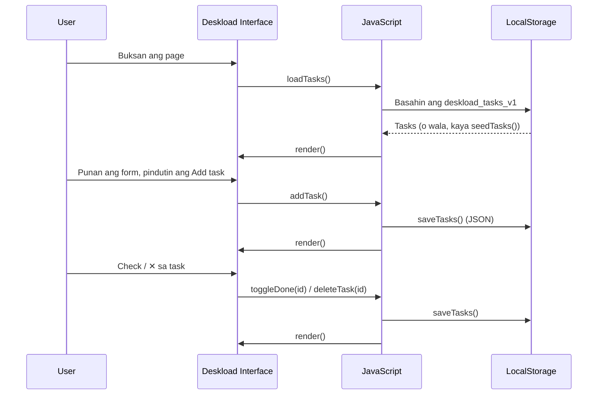

# Deskload — Student Task Tracker & Weekly Workload Planner

Isang web-based na task manager para sa mga estudyante. Dito nila nilalagay ang assignments, readings, at exams, tapos makikita agad kung alin ang overdue, due today, at kung aling subject ang pinakamabigat.

**Live demo:** https://ghennycisgonzales-beep.github.io/Deskload/
**Members:** [mga pangalan] | **Course:** [course code] | **Instructor:** [pangalan] | BSIT, 2026

Ito ay **front-end prototype (Week 1)**. Walang server at database pa. Ang data ay nasa browser lang gamit ang LocalStorage.

## Mga Feature

- Mag-add ng task na may title, due date, subject, at priority
- I-mark bilang tapos (checkbox) o i-delete ang task (✕)
- Awtomatikong **Overdue** at **Due today** na label
- Dashboard statistics: Open, Due Today, Overdue, Completed
- **Workload by subject** na bar chart (open tasks lang)
- Tuloy-tuloy ang data kahit i-close ang browser
- Responsive (mobile-friendly) at may awtomatikong dark mode
- **Reset all data** button para bumalik sa sample tasks

## Paano ito gumagana

Ang mga bahagi ng system:

| Component | Teknolohiya | Tungkulin |
|---|---|---|
| Interface | HTML5 + CSS3 | Form, task table, dashboard, styling |
| Logic | JavaScript (ES6+) | Add, complete, delete, deadline check, render |
| Storage | LocalStorage (Web Storage API) | Pag-save ng tasks sa browser ng user |
| Format ng data | JSON | `JSON.stringify()` para i-save, `JSON.parse()` para basahin |
| Fonts | Google Fonts | Source Serif 4 (headings), IBM Plex Sans (text) |

### Mga function sa `index.html`

| Function | Ginagawa |
|---|---|
| `loadTasks()` | Binabasa ang tasks mula LocalStorage; kung wala, tumatawag ng `seedTasks()` |
| `seedTasks()` | Gumagawa ng 3 sample tasks |
| `addTask()` | Kinukuha ang laman ng form, gumagawa ng task object, nagse-save, nagre-render |
| `toggleDone(id)` | Binabago ang status ng task (tapos / hindi pa) |
| `deleteTask(id)` | Tinatanggal ang task |
| `saveTasks(tasks)` | Kino-convert sa JSON at sine-save sa LocalStorage (may `try...catch`) |
| `dueClass()` / `dueLabel()` | Kinukumpara ang due date sa petsa ngayon para sa Overdue / Due today |
| `render()` | Nag-a-update ng stats, task table, at workload bars |
| `escapeHtml()` | Pinipigilan na masira ang page kung may special characters ang input |
| `resetAll()` | Ibinabalik sa sample tasks |

### Task object

```js
{ id, title, subject, due, priority, done }
```

## Daloy ng sistema



Mga hakbang:

1. Pagbukas ng page, tinatawag ang `loadTasks()` para kunin ang naka-save na tasks.
2. Kapag walang naka-save, gumagawa ng 3 sample tasks.
3. Pag-add ng task, gumagawa ng object na may unique `id`.
4. Sine-save ang buong listahan bilang JSON sa LocalStorage (key: `deskload_tasks_v1`).
5. Tinatawag ang `render()`, na iisang function na nagre-refresh ng buong screen.
6. Sa bawat render, kinukumpara ang due date sa petsa ngayon at kinukwenta ang stats at workload.

## Project structure

```
Deskload/
├── index.html   # Buong app (HTML + CSS + JavaScript)
└── README.md    # Dokumentasyong ito
```

## Paano i-run

**Online:** buksan ang live demo link sa taas.

**Local:**
```bash
git clone https://github.com/ghennycisgonzales-beep/Deskload.git
cd Deskload
# i-double click ang index.html para mabuksan sa browser
```
Walang kailangang i-install, walang server.

## LocalStorage

| Key | Laman |
|---|---|
| `deskload_tasks_v1` | Listahan ng lahat ng tasks (JSON) |

## Troubleshooting

| Problema | Solusyon |
|---|---|
| Nawala ang mga tasks | Hiwalay ang LocalStorage kada browser, kada link, at kapag naka-incognito. I-check kung pareho ang browser at link na ginamit |
| Sample tasks lang ang lumalabas | Wala pang naka-save sa browser na ito, o na-click ang **Reset all data** |
| 404 sa GitHub Pages | Siguraduhing `index.html` ang pangalan ng file at naka-set ang Pages sa `main` / `root` |
| Iba ang font | Kailangan ng internet ang Google Fonts; gagana pa rin ang app kahit wala |
| Hindi nagse-save ang task | Posibleng naka-block ang LocalStorage (private mode); hindi magka-crash ang app dahil sa `try...catch` |

## Mga limitasyon

- Ang data ay nasa isang browser lang; walang accounts at walang sync sa ibang device
- Walang edit feature para sa existing task (delete at add ulit)
- Ang priority ay ipinapakita lang; hindi ito ginagamit sa pag-sort
- Ginagamit ang UTC date sa pagkuha ng "today", kaya posibleng mali ng isang araw ang Overdue / Due today sa pagitan ng 12:00 AM at 8:00 AM sa Pilipinas
- Front-end prototype pa lang ito

## Mga posibleng pagpapabuti

- Gumawa ng **TaskService REST API** (create, complete, list) sa backend
- Database at user accounts para sa online storage at multi-device access
- Edit feature at sorting ayon sa priority
- Ayusin ang timezone handling sa due dates
- PWA (manifest at service worker) para ma-install at gumana offline

## Tech stack

HTML5 · CSS3 · JavaScript (ES6+) · LocalStorage · Google Fonts

## References (MDN Web Docs)

- HTML: https://developer.mozilla.org/en-US/docs/Web/HTML
- CSS: https://developer.mozilla.org/en-US/docs/Web/CSS
- JavaScript: https://developer.mozilla.org/en-US/docs/Web/JavaScript
- CSS custom properties: https://developer.mozilla.org/en-US/docs/Web/CSS/Using_CSS_custom_properties
- prefers-color-scheme: https://developer.mozilla.org/en-US/docs/Web/CSS/@media/prefers-color-scheme
- Flexbox: https://developer.mozilla.org/en-US/docs/Web/CSS/CSS_flexbox
- CSS Grid: https://developer.mozilla.org/en-US/docs/Web/CSS/CSS_grid_layout
- Media queries: https://developer.mozilla.org/en-US/docs/Web/CSS/CSS_media_queries/Using_media_queries
- Web Storage API: https://developer.mozilla.org/en-US/docs/Web/API/Web_Storage_API
- JSON: https://developer.mozilla.org/en-US/docs/Web/JavaScript/Reference/Global_Objects/JSON
- Array methods: https://developer.mozilla.org/en-US/docs/Web/JavaScript/Reference/Global_Objects/Array
- Template literals: https://developer.mozilla.org/en-US/docs/Web/JavaScript/Reference/Template_literals
- Date: https://developer.mozilla.org/en-US/docs/Web/JavaScript/Reference/Global_Objects/Date
- DOM: https://developer.mozilla.org/en-US/docs/Web/API/Document_Object_Model
- try...catch: https://developer.mozilla.org/en-US/docs/Web/JavaScript/Reference/Statements/try...catch
